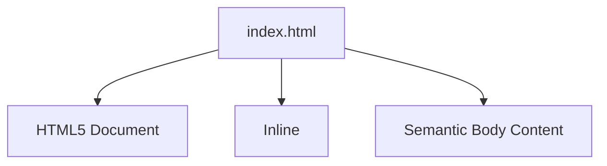
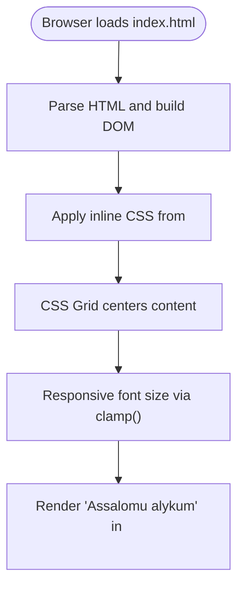
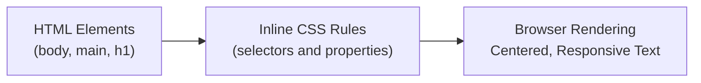

# Code Structure

<cite>
**Referenced Files in This Document**
- [index.html](file://index.html)
</cite>

## Table of Contents
1. [Introduction](#introduction)
2. [Project Structure](#project-structure)
3. [Core Components](#core-components)
4. [Architecture Overview](#architecture-overview)
5. [Detailed Component Analysis](#detailed-component-analysis)
6. [Dependency Analysis](#dependency-analysis)
7. [Performance Considerations](#performance-considerations)
8. [Troubleshooting Guide](#troubleshooting-guide)
9. [Conclusion](#conclusion)

## Introduction
This document explains the code structure of a single-file web project that combines HTML and CSS in one file. It focuses on the HTML5 document structure, inline CSS styling approach (including CSS Grid and responsive typography), and how the HTML and CSS work together to display an Uzbek greeting message. The goal is to make the architecture clear for both technical and non-technical readers.

## Project Structure
The project consists of a single file: index.html. This monolithic file contains the complete HTML5 document, including metadata, styles, and content. There are no external assets or separate style files.

**Diagram sources**
- [index.html:1-30](file://index.html#L1-L30)

**Section sources**
- [index.html:1-30](file://index.html#L1-L30)

## Core Components
- DOCTYPE declaration: Declares the document as HTML5.
- Root html element: Uses the lang attribute set to "uz" to indicate Uzbek language content.
- Head section: Contains character encoding, viewport configuration, page title, and an inline style block.
- Body section: Contains a semantic main element with a heading displaying the Uzbek greeting.

Key responsibilities:
- HTML defines the structure and semantics.
- Inline CSS provides layout and presentation within the same file.

**Section sources**
- [index.html:1-30](file://index.html#L1-L30)

## Architecture Overview
In this single-file architecture, the browser loads index.html once and parses it into the DOM. The inline <style> block applies CSS rules directly to the elements defined in the body. The result is a centered, responsive greeting rendered using CSS Grid and clamp-based typography.

**Diagram sources**
- [index.html:1-30](file://index.html#L1-L30)

## Detailed Component Analysis

### HTML5 Document Structure
- DOCTYPE: Ensures standards-compliant rendering.
- Root element: <html lang="uz"> sets the page language to Uzbek, improving accessibility and search indexing.
- Head:
  - Character set meta tag ensures correct text encoding.
  - Viewport meta tag enables mobile-friendly scaling.
  - Title sets the tab label.
  - Inline <style> block defines all visual rules.
- Body:
  - Semantic <main> wraps primary content.
  - <h1> displays the Uzbek greeting.

Concrete example mapping:
- Language attribute: root html element uses "uz".
- Greeting content: <h1> inside <main> shows the Uzbek greeting.

**Section sources**
- [index.html:1-30](file://index.html#L1-L30)

### Inline CSS Styling Approach
- Reset and base:
  - Removes default margins and sets minimum height to full viewport.
  - Centers content vertically and horizontally using CSS Grid.
  - Adds padding and sets a serif font stack.
- Typography:
  - Uses clamp() to scale the heading size responsively between a minimum and maximum value based on viewport width.
  - Normalizes font weight and aligns text to center.

How HTML and CSS interact:
- The <body> selector applies grid layout and global typography.
- The <h1> selector overrides sizing and weight for the greeting.

**Section sources**
- [index.html:7-23](file://index.html#L7-L23)

### CSS Grid Layout System
- The body is configured as a grid container.
- place-items: center centers child nodes both horizontally and vertically.
- min-height: 100vh ensures the grid covers at least the full viewport height.

Result:
- The greeting appears centered on the screen regardless of device size.

**Section sources**
- [index.html:8-17](file://index.html#L8-L17)

### Responsive Typography Using clamp()
- The h1 font-size uses clamp(min, preferred, max).
- This scales the heading fluidly with viewport width while respecting min and max bounds.

Benefits:
- Smooth scaling without media queries.
- Consistent readability across devices.

**Section sources**
- [index.html:18-22](file://index.html#L18-L22)

### Font Family Specifications
- The body uses a serif font stack prioritizing Georgia, then Times New Roman, and finally any available serif font.
- This ensures consistent typographic appearance across platforms.

**Section sources**
- [index.html:14-16](file://index.html#L14-L16)

### Concrete Example: Uzbek Greeting Display and Styling
- Markup: <main> contains <h1> with the Uzbek greeting text.
- Presentation:
  - Centered by CSS Grid on the body.
  - Sized responsively by clamp() on the h1.
  - Styled with the specified serif font family.

Visual flow:
- HTML provides the semantic structure and text.
- CSS positions and sizes the text for optimal viewing.

**Section sources**
- [index.html:25-28](file://index.html#L25-L28)
- [index.html:8-22](file://index.html#L8-L22)

## Dependency Analysis
Because this is a single-file project, there are no external dependencies. All presentation logic resides in the inline <style> block, and all content resides in the body. The only relationship is between selectors and elements within the same file.

**Diagram sources**
- [index.html:1-30](file://index.html#L1-L30)

**Section sources**
- [index.html:1-30](file://index.html#L1-L30)

## Performance Considerations
- Single HTTP request reduces network overhead compared to multiple files.
- No external resources to load; faster initial render.
- Inline CSS avoids additional stylesheet parsing but increases file size.
- clamp() avoids extra CSS rules for breakpoints, simplifying the stylesheet.

[No sources needed since this section provides general guidance]

## Troubleshooting Guide
- Incorrect language setting: Ensure the root html element has lang="uz" for proper localization behavior.
- Mobile scaling issues: Verify the viewport meta tag is present and correctly configured.
- Centering not working: Confirm the body is styled as a grid container with place-items: center and sufficient height.
- Font not rendering as expected: Check the font-family stack and ensure the system has the specified fonts installed.
- Heading size too large/small: Adjust the clamp() values to fit design requirements.

**Section sources**
- [index.html:2-6](file://index.html#L2-L6)
- [index.html:8-22](file://index.html#L8-L22)

## Conclusion
This single-file project demonstrates a clean separation of concerns within one document: HTML defines structure and semantics, while inline CSS handles layout and presentation. The use of CSS Grid and clamp() provides a simple yet effective responsive design. While this monolithic approach offers simplicity and fast loading, it can become harder to maintain as projects grow. For small prototypes or landing pages, however, it remains a practical and efficient choice.

[No sources needed since this section summarizes without analyzing specific files]