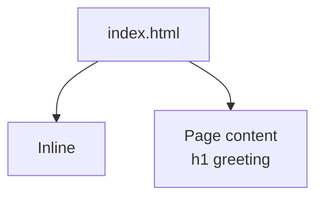
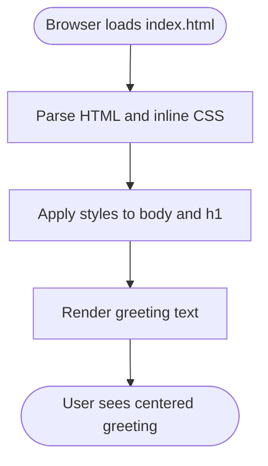
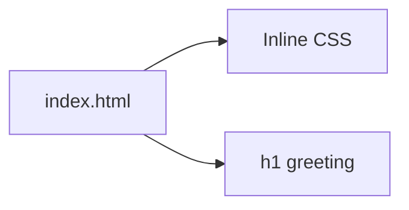

# Customization Guide

<cite>
**Referenced Files in This Document**
- [index.html](file://index.html)
</cite>

## Table of Contents
1. [Introduction](#introduction)
2. [Project Structure](#project-structure)
3. [Core Components](#core-components)
4. [Architecture Overview](#architecture-overview)
5. [Detailed Component Analysis](#detailed-component-analysis)
6. [Dependency Analysis](#dependency-analysis)
7. [Performance Considerations](#performance-considerations)
8. [Troubleshooting Guide](#troubleshooting-guide)
9. [Conclusion](#conclusion)
10. [Appendices](#appendices)

## Introduction
This guide explains how to customize a minimal static website that currently consists of a single HTML file. You will learn how to:
- Modify the Uzbek greeting message content by editing the h1 element text
- Change styling properties (colors, fonts, spacing, layout) via inline CSS styles
- Add new pages and link them together
- Move CSS into external stylesheet files for better organization
- Add JavaScript functionality using script tags or external JS files
- Maintain clean code structure as your site grows beyond a single file

The guidance is practical and step-by-step, with references to the exact locations in the source file where changes should be made.

## Project Structure
At present, the project contains one file: index.html. It includes both the page content and the inline CSS within the same document. As you expand the site, you can introduce additional HTML files and an external CSS file.

**Diagram sources**
- [index.html:1-31](file://index.html#L1-L31)

**Section sources**
- [index.html:1-31](file://index.html#L1-L31)

## Core Components
- Page shell: The HTML document structure defines the language, viewport, title, and embedded style block.
- Inline styles: The CSS inside the style block controls body layout, typography, and the h1 heading.
- Content: The main area contains a single h1 element displaying the Uzbek greeting.

Key areas to edit:
- Greeting text: Edit the h1 element’s text node.
- Styling: Adjust properties in the style block such as colors, fonts, spacing, and layout.

**Section sources**
- [index.html:1-31](file://index.html#L1-L31)

## Architecture Overview
Conceptually, this site follows a simple flow:
- Browser loads index.html
- Styles from the inline style block are applied
- The h1 greeting is rendered centered on the page

[No sources needed since this diagram shows conceptual workflow, not actual code structure]

## Detailed Component Analysis

### Modifying the Uzbek Greeting Message
- Locate the h1 element containing the greeting text.
- Replace its text content with your desired message while preserving the surrounding elements.

Where to edit:
- The h1 element is located within the main content area.

Best practices:
- Keep the text concise and meaningful.
- If you plan to support multiple languages later, consider adding data attributes or structured content for translation.

**Section sources**
- [index.html:25-28](file://index.html#L25-L28)

### Changing Styling Properties (Colors, Fonts, Spacing, Layout)
You can modify the inline CSS to change appearance and layout:
- Colors: Set background-color on the body and color on the h1.
- Fonts: Adjust font-family, font-size, line-height, and font-weight.
- Spacing: Tweak padding and margin values.
- Layout: Use display and alignment utilities already present; adjust min-height or place-items if needed.

Where to edit:
- The style block contains rules for body and h1.

Examples of common customizations:
- Change background color: Update the background-color property under the body rule.
- Change text color: Update the color property under the h1 rule.
- Adjust font size: Modify the font-size property under the h1 rule.
- Increase spacing around the page: Increase the padding value under the body rule.

Note: The current layout uses a grid-based centering approach with place-items. You can keep this pattern and adjust values to suit your design.

**Section sources**
- [index.html:7-23](file://index.html#L7-L23)
- [index.html:18-22](file://index.html#L18-L22)

### Adding New Pages and Linking Them Together
To add a new page:
1. Create a new HTML file (for example, about.html).
2. Copy the basic structure from index.html into the new file.
3. Customize the content and title for the new page.
4. Add a navigation link in index.html pointing to the new page.

Where to add links:
- Insert an anchor element near the greeting or at the top of the page.
- Use href="about.html" to link to the new page.

Example steps:
- In index.html, add a link like “About” that points to about.html.
- In about.html, include your own content and optionally reuse the same style block or move styles to an external file.

**Section sources**
- [index.html:25-28](file://index.html#L25-L28)

### Moving CSS to an External Stylesheet
To organize styles:
1. Create a new file named styles.css in the same directory as index.html.
2. Cut the entire style block from index.html and paste it into styles.css.
3. In index.html, add a link tag in the head section to reference styles.css.
4. Remove the original style block from index.html.

Benefits:
- Cleaner HTML markup
- Easier maintenance and reuse across multiple pages
- Better caching behavior for browsers

Where to edit:
- Remove the style block from index.html.
- Add a link tag referencing styles.css in the head section.

**Section sources**
- [index.html:7-23](file://index.html#L7-L23)

### Adding JavaScript Functionality
To add interactivity:
- Inline scripts: Add a script tag before the closing body tag to run small snippets directly.
- External scripts: Create a file like app.js and link it with a script tag in the head or just before the closing body tag.

Common patterns:
- Log a message when the page loads
- Attach event listeners to buttons or links
- Manipulate DOM elements (e.g., toggle classes, update text)

Where to add:
- Place a script tag at the end of the body in index.html for inline scripts.
- For external scripts, add a script tag with src="app.js".

**Section sources**
- [index.html:25-30](file://index.html#L25-L30)

### Best Practices for Clean Code Structure
As your site grows:
- Separate concerns: Keep HTML, CSS, and JS in their own files.
- Organize CSS: Group related rules and use consistent naming conventions.
- Reuse components: Extract repeated structures into partials or templates if you adopt a build tool later.
- Comment strategically: Add brief comments to explain non-obvious logic or customization points.
- Validate and test: Ensure links work, styles apply correctly, and scripts run without errors.

[No sources needed since this section provides general guidance]

## Dependency Analysis
Currently, there are no external dependencies. The page relies solely on the browser’s default rendering engine and the inline CSS.

**Diagram sources**
- [index.html:1-31](file://index.html#L1-L31)

**Section sources**
- [index.html:1-31](file://index.html#L1-L31)

## Performance Considerations
- Keep the initial payload small: Inline CSS is fine for a single-page site, but moving styles to an external file improves caching and reduces duplication across pages.
- Avoid heavy scripts: Load only what you need, and defer or async load scripts if they are not critical for initial rendering.
- Optimize images: If you add images later, use appropriate formats and sizes.

[No sources needed since this section provides general guidance]

## Troubleshooting Guide
- Greeting text not updating:
  - Verify you edited the correct h1 element and saved the file.
  - Clear browser cache or hard refresh to see changes.
- Styles not applying:
  - Check that the style block is still present or that the external stylesheet link is correct.
  - Inspect the element in the browser developer tools to confirm which rules are active.
- Links not working:
  - Confirm the href attribute points to the correct filename and path.
  - Ensure the target file exists in the same directory.
- Scripts not running:
  - Check for syntax errors in the console.
  - Verify script tags are placed correctly and paths are accurate.

**Section sources**
- [index.html:7-23](file://index.html#L7-L23)
- [index.html:25-30](file://index.html#L25-L30)

## Conclusion
You now have a clear roadmap for customizing this static website:
- Update the greeting text in the h1 element
- Adjust inline CSS to control colors, fonts, spacing, and layout
- Add new pages and link them from index.html
- Move CSS to an external stylesheet for maintainability
- Introduce JavaScript for interactivity
- Follow best practices to keep your codebase organized as it grows

[No sources needed since this section summarizes without analyzing specific files]

## Appendices

### Quick Reference: Where to Edit
- Greeting text: Edit the h1 element’s text content.
- Inline styles: Modify the style block for body and h1.
- Navigation links: Add anchor elements in the main content area.
- External CSS: Create styles.css and link it from index.html.
- JavaScript: Add script tags or link external JS files.

**Section sources**
- [index.html:7-23](file://index.html#L7-L23)
- [index.html:25-28](file://index.html#L25-L28)