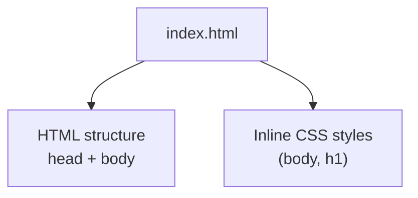
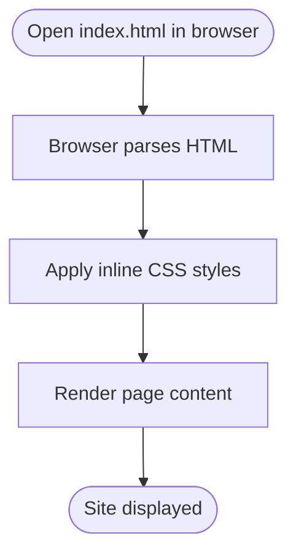
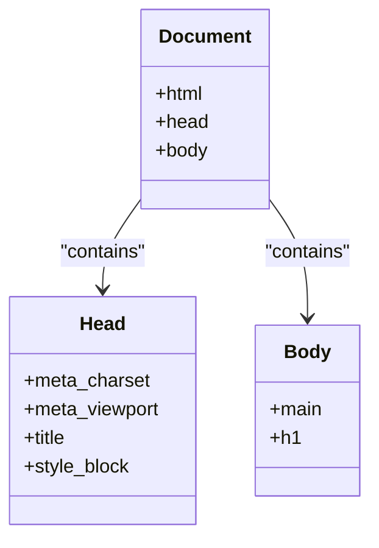
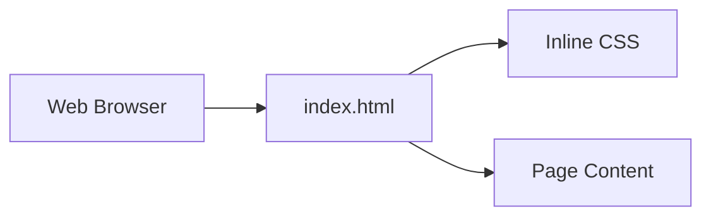

# Getting Started

<cite>
**Referenced Files in This Document**   
- [index.html](file://index.html)
</cite>

## Table of Contents
1. [Introduction](#introduction)
2. [Project Structure](#project-structure)
3. [Core Components](#core-components)
4. [Architecture Overview](#architecture-overview)
5. [Detailed Component Analysis](#detailed-component-analysis)
6. [Dependency Analysis](#dependency-analysis)
7. [Performance Considerations](#performance-considerations)
8. [Troubleshooting Guide](#troubleshooting-guide)
9. [Conclusion](#conclusion)

## Introduction
This project is a minimal, single-page website contained entirely within one HTML file. It has no external dependencies and requires no installation or build step. You can view it locally by opening the index.html file in any modern web browser. The page includes its own CSS styles, so everything you need to render the site is already present in that single file.

## Project Structure
The repository contains a single file:
- index.html — the complete website (HTML structure and CSS styling)

**Diagram sources**
- [index.html:1-30](file://index.html#L1-L30)

**Section sources**
- [index.html:1-30](file://index.html#L1-L30)

## Core Components
- Single-file architecture: All markup and styling live in one document.
- Inline CSS: Styles are defined inside a <style> block within the head.
- Semantic HTML: Uses basic semantic elements like html, head, meta, title, style, body, main, and h1.
- Responsive basics: Includes viewport meta tag and fluid typography using clamp for scalable headings.

What this means for you:
- No server required to view the site locally.
- No package manager or build tools needed.
- Easy to edit with any text editor.

**Section sources**
- [index.html:1-30](file://index.html#L1-L30)

## Architecture Overview
At runtime, the browser loads index.html and renders:
- The document metadata (charset, viewport, title).
- The inline CSS rules for layout and typography.
- The visible content centered on the screen.

[No sources needed since this diagram shows conceptual workflow, not actual code structure]

## Detailed Component Analysis

### File: index.html
- Purpose: Defines the entire website’s structure and appearance.
- Key sections:
  - Head: Contains metadata and inline CSS.
  - Body: Contains the main content area with a heading.

**Diagram sources**
- [index.html:1-30](file://index.html#L1-L30)

**Section sources**
- [index.html:1-30](file://index.html#L1-L30)

## Dependency Analysis
- External dependencies: None.
- Local resources: None.
- Network requests: None at load time.

**Diagram sources**
- [index.html:1-30](file://index.html#L1-L30)

**Section sources**
- [index.html:1-30](file://index.html#L1-L30)

## Performance Considerations
- Very lightweight: Only one small HTML file with minimal CSS.
- Fast local loading: No network overhead; rendering is immediate.
- Simple to optimize further if needed: Keep CSS minimal and avoid heavy assets.

[No sources needed since this section provides general guidance]

## Troubleshooting Guide

Common questions
- How do I view the website?
  - Double-click index.html or open it from your file explorer in any modern browser.
- Do I need to install anything?
  - No. There are no dependencies or installation steps.
- Why does the page look different in my editor preview?
  - Some editors’ built-in previews may not fully emulate a browser. Open index.html directly in a browser for accurate results.

Display issues checklist
- Blank or unstyled page
  - Ensure you opened index.html directly in a browser, not via a custom protocol or restricted environment.
  - Confirm the file path is correct and the file is not corrupted.
- Text too large/small or misaligned
  - Check your browser zoom level (Ctrl/Cmd + 0 resets zoom).
  - Verify the viewport meta tag is present and not removed.
- Font looks unexpected
  - The page uses system serif fonts; availability varies by OS. This is expected behavior.
- Mobile-like scaling seems off
  - The viewport meta tag enables responsive scaling. If it appears incorrect, try rotating the device or resizing the browser window.

If problems persist
- Try another modern browser (Chrome, Edge, Firefox, Safari).
- Disable browser extensions temporarily to rule out interference.
- Clear the browser cache and reload.

**Section sources**
- [index.html:1-30](file://index.html#L1-L30)

## Conclusion
You can run this project instantly by opening index.html in a browser—no setup required. The single-file design keeps things simple and portable. Use any text editor to inspect or modify the markup and styles, then refresh your browser to see changes.

[No sources needed since this section summarizes without analyzing specific files]