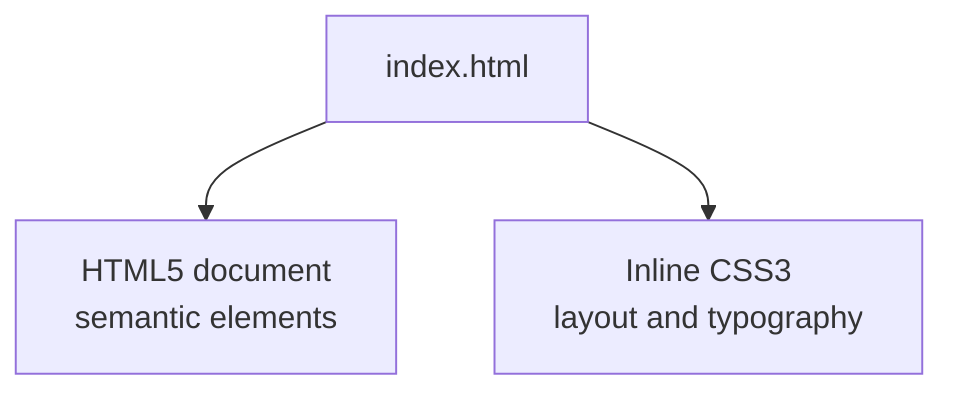
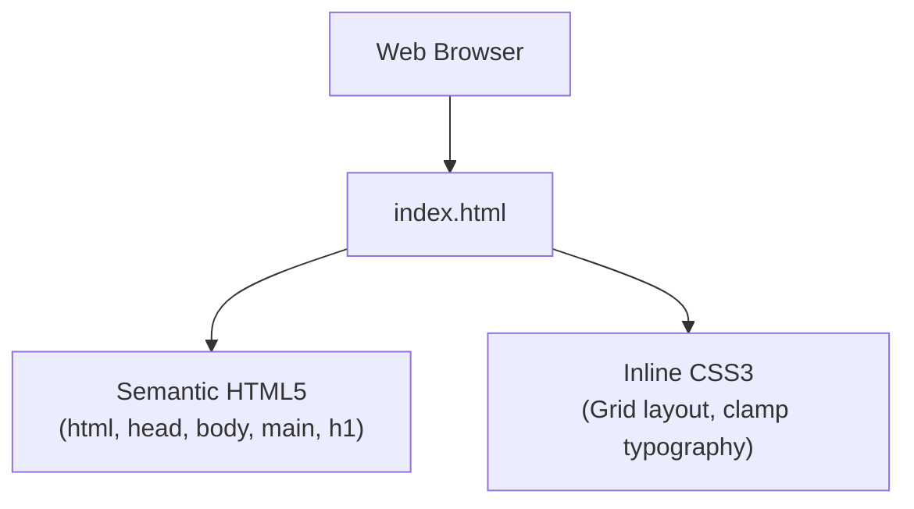
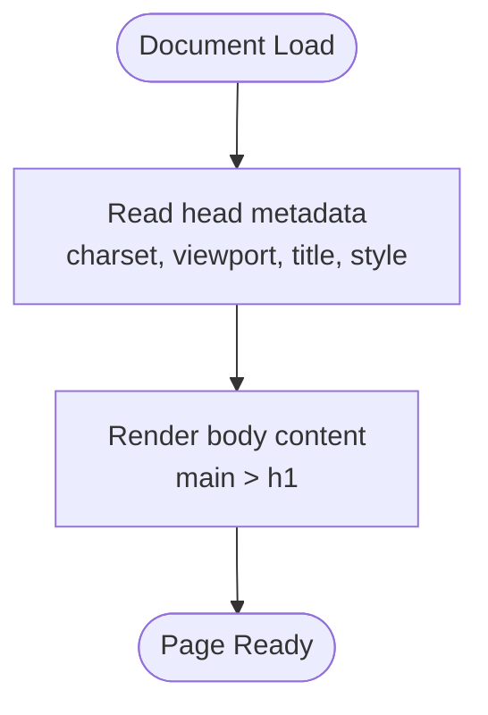
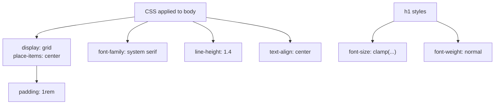
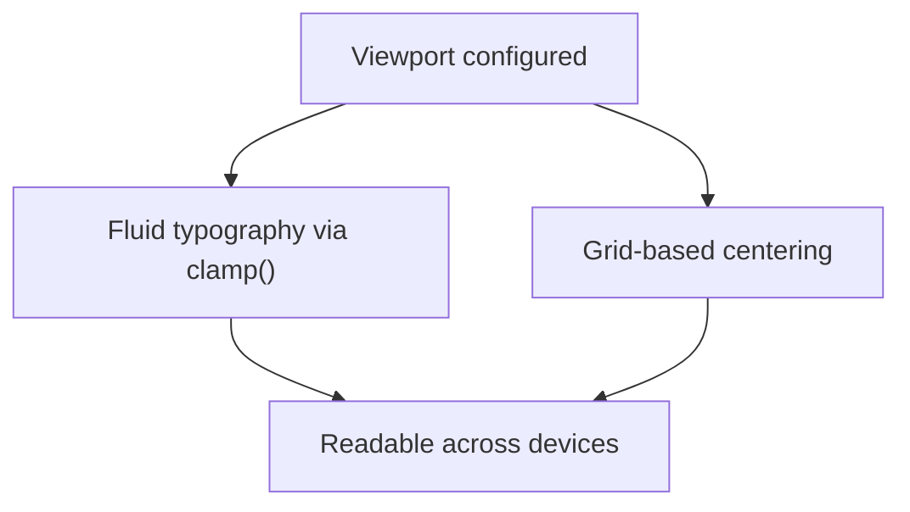
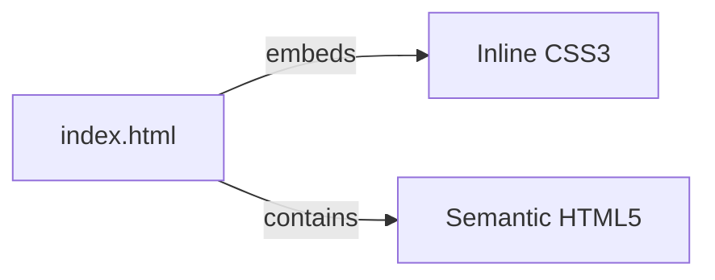

# Project Overview

<cite>
**Referenced Files in This Document**
- [index.html](file://index.html)
</cite>

## Table of Contents
1. [Introduction](#introduction)
2. [Project Structure](#project-structure)
3. [Core Components](#core-components)
4. [Architecture Overview](#architecture-overview)
5. [Detailed Component Analysis](#detailed-component-analysis)
6. [Dependency Analysis](#dependency-analysis)
7. [Performance Considerations](#performance-considerations)
8. [Troubleshooting Guide](#troubleshooting-guide)
9. [Conclusion](#conclusion)

## Introduction
This project is a minimal, single-page static website that displays an Uzbek greeting message. It uses semantic HTML5 for structure and CSS3 with inline styling for presentation. The design follows a mobile-first approach and leverages responsive typography to ensure readability across devices.

Key characteristics:
- Purpose: Provide a simple web presence centered on a greeting message.
- Technology stack: HTML5 and CSS3 only; no JavaScript or external assets.
- Styling approach: Inline CSS within the document’s head using modern layout and typography features.
- Responsiveness: Mobile-first viewport configuration and fluid sizing via clamp-based font scaling.

## Project Structure
The repository contains a single entry point:
- index.html: The complete page markup and embedded styles.

**Diagram sources**
- [index.html:1-31](file://index.html#L1-L31)

**Section sources**
- [index.html:1-31](file://index.html#L1-L31)

## Core Components
- Semantic HTML5 structure:
  - html element declares the language as Uzbek (uz).
  - head includes charset, viewport meta tag, title, and style block.
  - body contains a main landmark with a heading displaying the greeting.
- Inline CSS3 styling:
  - Body uses CSS Grid to center content vertically and horizontally.
  - Fluid typography is achieved with clamp() for scalable headings.
  - System serif fonts are used for broad compatibility.

Practical examples from the current implementation:
- Viewport configuration for mobile-first responsiveness.
- Centering content using grid placement.
- Responsive heading size using clamp().

**Section sources**
- [index.html:1-31](file://index.html#L1-L31)

## Architecture Overview
At a high level, the site is a self-contained HTML document with embedded styles. There are no external dependencies, build steps, or runtime scripts.

**Diagram sources**
- [index.html:1-31](file://index.html#L1-L31)

## Detailed Component Analysis

### HTML Structure
- Language attribute set to Uzbek for correct text rendering and accessibility.
- Head section defines character encoding, viewport settings, page title, and embedded styles.
- Body contains a main landmark element with a single heading for the greeting.

**Diagram sources**
- [index.html:1-31](file://index.html#L1-L31)

**Section sources**
- [index.html:1-31](file://index.html#L1-L31)

### CSS Styling and Layout
- Mobile-first viewport ensures proper scaling on small screens.
- CSS Grid is used to center the content both vertically and horizontally.
- Typography scales responsively using clamp(), providing smooth font-size transitions across viewports.
- System serif fonts improve cross-browser consistency and performance by avoiding external font requests.

**Diagram sources**
- [index.html:7-23](file://index.html#L7-L23)

**Section sources**
- [index.html:7-23](file://index.html#L7-L23)

### Responsive Design Approach
- Viewport meta tag configures width and initial scale for mobile devices.
- clamp() enables fluid typography without media queries.
- Grid centering adapts naturally to any screen size.

**Diagram sources**
- [index.html:5-22](file://index.html#L5-L22)

**Section sources**
- [index.html:5-22](file://index.html#L5-L22)

### Cross-Browser Compatibility
- Uses widely supported features: CSS Grid, clamp(), and standard HTML5 elements.
- Avoids vendor prefixes and experimental properties.
- Relies on system fonts to minimize rendering differences across browsers.

[No sources needed since this section provides general guidance]

## Dependency Analysis
- External dependencies: None.
- Internal dependencies: The page is self-contained; styles are embedded directly in the document.
- No JavaScript or third-party libraries are present.

**Diagram sources**
- [index.html:1-31](file://index.html#L1-L31)

**Section sources**
- [index.html:1-31](file://index.html#L1-L31)

## Performance Considerations
- Zero network overhead beyond the single HTML file.
- No external resources (fonts, images, scripts) reduce load time.
- Minimal DOM and CSS surface area improves parsing and rendering speed.
- Using system fonts avoids additional downloads and layout shifts.

[No sources needed since this section provides general guidance]

## Troubleshooting Guide
- Greeting not visible:
  - Verify the main element and h1 are present in the body.
  - Ensure the document is served with UTF-8 encoding.
- Text appears too large or too small:
  - Check the clamp() usage for the heading and adjust min/max values if needed.
- Content not centered:
  - Confirm that the body uses display: grid and place-items: center.
- Mobile scaling issues:
  - Ensure the viewport meta tag is present and correctly configured.

**Section sources**
- [index.html:1-31](file://index.html#L1-L31)

## Conclusion
This project demonstrates a clean, efficient approach to building a single-page static site. By combining semantic HTML5 with concise inline CSS3, it achieves a responsive, accessible, and fast-loading experience. The use of CSS Grid and clamp() showcases modern techniques while maintaining simplicity and broad compatibility.

[No sources needed since this section summarizes without analyzing specific files]