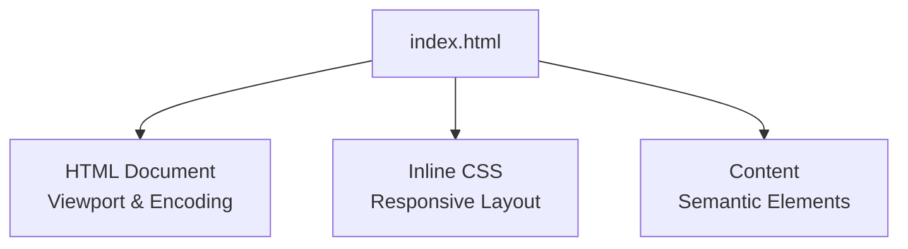
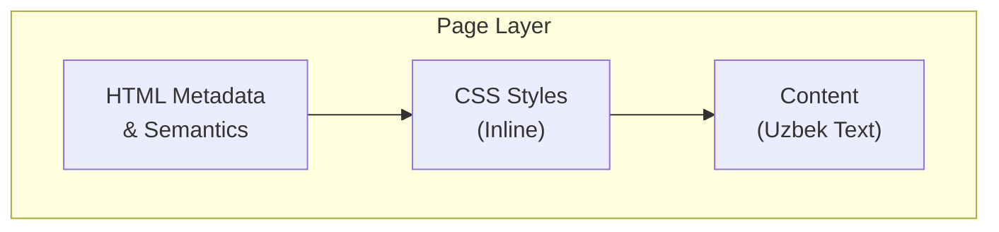
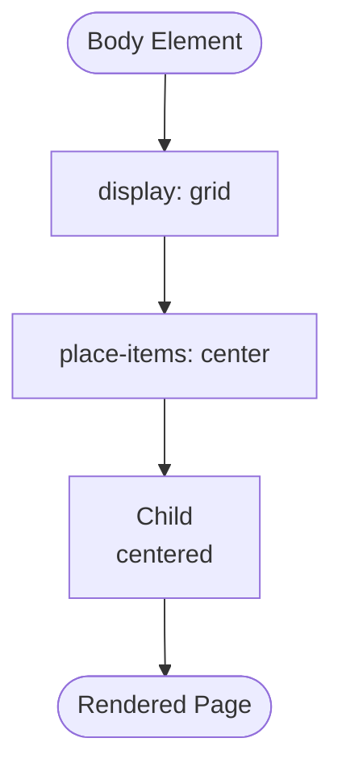
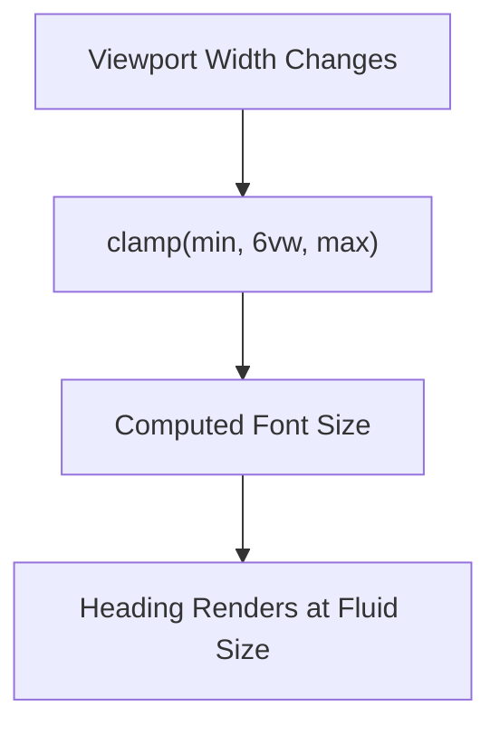
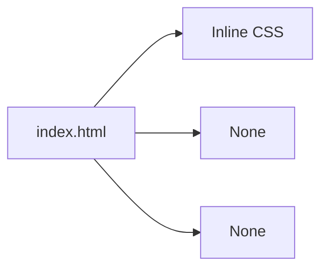

# Technical Implementation

<cite>
**Referenced Files in This Document**
- [index.html](file://index.html)
</cite>

## Table of Contents
1. [Introduction](#introduction)
2. [Project Structure](#project-structure)
3. [Core Components](#core-components)
4. [Architecture Overview](#architecture-overview)
5. [Detailed Component Analysis](#detailed-component-analysis)
6. [Dependency Analysis](#dependency-analysis)
7. [Performance Considerations](#performance-considerations)
8. [Troubleshooting Guide](#troubleshooting-guide)
9. [Conclusion](#conclusion)

## Introduction
This document explains the technical implementation of a minimal static website that displays Uzbek text (“Assalomu alykum”). It focuses on responsive design techniques, Unicode encoding for proper text rendering, cross-browser compatibility, performance characteristics, and accessibility considerations. The site is implemented as a single HTML file with embedded CSS, emphasizing simplicity and fast loading.

## Project Structure
The project consists of a single entry point:
- index.html: Contains the complete page structure, metadata, and inline styles.

**Diagram sources**
- [index.html:1-30](file://index.html#L1-L30)

**Section sources**
- [index.html:1-30](file://index.html#L1-L30)

## Core Components
- Viewport meta tag: Ensures correct scaling on mobile devices by setting width to device-width and initial-scale to 1.
- Unicode character encoding: Declares UTF-8 to correctly render Uzbek characters.
- Responsive layout: Uses CSS Grid with place-items centering to vertically and horizontally center content within the viewport.
- Fluid typography: Applies clamp() to scale heading size based on viewport width while maintaining minimum and maximum bounds.
- Semantic markup: Uses <main> and <h1> to provide meaningful structure and improve accessibility.
- Language attribution: Sets lang="uz" to indicate Uzbek language content.

**Section sources**
- [index.html:1-30](file://index.html#L1-L30)

## Architecture Overview
At a high level, the page follows a simple architecture:
- HTML layer defines semantic structure and metadata.
- CSS layer (inline) provides responsive layout and fluid typography.
- Content layer presents the greeting message in Uzbek.

[No sources needed since this diagram shows conceptual workflow, not actual code structure]

## Detailed Component Analysis

### Viewport Meta Tag Configuration
- Purpose: Controls how the browser renders the page on different screen sizes.
- Behavior: width=device-width sets the layout width to match the device’s screen width; initial-scale=1 disables default zoom at load time.
- Impact: Ensures consistent layout across mobile and desktop browsers.

**Section sources**
- [index.html:5](file://index.html#L5)

### CSS Grid Centering with place-items
- Technique: body uses display: grid and place-items: center to center its child (<main>) both horizontally and vertically.
- Benefits: Simple, robust centering without extra wrapper elements or absolute positioning.
- Compatibility: Supported in all modern browsers; fallbacks are not required for basic centering needs.

**Diagram sources**
- [index.html:8-17](file://index.html#L8-L17)

**Section sources**
- [index.html:8-17](file://index.html#L8-L17)

### Fluid Typography Using clamp()
- Technique: h1 font-size uses clamp(min, preferred, max) to scale between a minimum and maximum size based on viewport width.
- Example behavior: The heading scales smoothly from a smaller base size up to a larger cap as the viewport grows.
- Advantages: Eliminates media queries for simple scaling and improves readability across devices.

**Diagram sources**
- [index.html:18-22](file://index.html#L18-L22)

**Section sources**
- [index.html:18-22](file://index.html#L18-L22)

### Unicode Character Encoding for Uzbek Text
- Declaration: charset is set to UTF-8 to ensure correct rendering of non-Latin scripts.
- Result: Uzbek characters such as “Assalomu alykum” display correctly across browsers and platforms.
- Best practice: Always declare UTF-8 early in the document head.

**Section sources**
- [index.html:4](file://index.html#L4)
- [index.html:27](file://index.html#L27)

### Cross-Browser Compatibility and Standards
- HTML5 doctype and attributes: Uses <!DOCTYPE html> and standard attributes like lang and charset.
- CSS features: Uses widely supported properties (grid, place-items, clamp).
- Fallbacks: No explicit fallbacks are necessary for these features in modern environments.

**Section sources**
- [index.html:1-30](file://index.html#L1-L30)

### Accessibility Features
- Semantic elements: <main> and <h1> convey document structure and hierarchy to assistive technologies.
- Language attribute: lang="uz" helps screen readers pronounce content appropriately.
- Readability: Adequate line-height and text alignment improve legibility.

**Section sources**
- [index.html:2](file://index.html#L2)
- [index.html:26-28](file://index.html#L26-L28)

## Dependency Analysis
This project has no external dependencies:
- No external CSS or JavaScript files.
- All styling is inline within the document.
- Single-file architecture minimizes network requests and simplifies deployment.

**Diagram sources**
- [index.html:1-30](file://index.html#L1-L30)

**Section sources**
- [index.html:1-30](file://index.html#L1-L30)

## Performance Considerations
- Minimal file size: A single small HTML file reduces payload and parsing overhead.
- Fast loading times: Inline CSS avoids additional HTTP requests; no external resources to fetch.
- Efficient rendering: Simple DOM tree and minimal CSS enable quick paint and layout.
- Optimization opportunities:
  - Keep content concise to reduce document size.
  - Avoid heavy fonts or large images unless necessary.
  - Consider caching strategies if hosted on a web server.

[No sources needed since this section provides general guidance]

## Troubleshooting Guide
- Text appears garbled or incorrect:
  - Ensure charset is declared as UTF-8.
  - Verify the editor saves the file as UTF-8.
- Content not centered on some devices:
  - Confirm viewport meta tag is present and correct.
  - Check that body uses grid with place-items center.
- Heading size does not scale:
  - Verify clamp() syntax and that min/preferred/max values are valid.
  - Test on multiple viewport widths to confirm scaling behavior.
- Screen readers mispronounce text:
  - Ensure lang="uz" is set on the <html> element.
- Mobile zoom issues:
  - Confirm initial-scale=1 is set in the viewport meta tag.

**Section sources**
- [index.html:2](file://index.html#L2)
- [index.html:4](file://index.html#L4)
- [index.html:5](file://index.html#L5)
- [index.html:8-17](file://index.html#L8-L17)
- [index.html:18-22](file://index.html#L18-L22)

## Conclusion
This static website demonstrates a clean, standards-compliant approach to building a responsive, accessible, and performant page. By leveraging the viewport meta tag, CSS Grid centering, and fluid typography via clamp(), it adapts gracefully across devices. UTF-8 encoding ensures correct display of Uzbek text, while semantic markup and language attributes support accessibility. The single-file design keeps the project lightweight and easy to deploy.